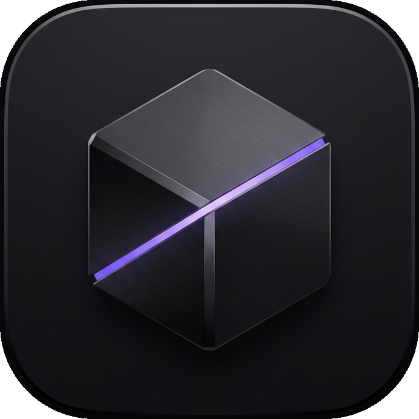

<p align="center">
  
</p>

<h1 align="center">Cadence</h1>

<p align="center">
  Fast, native Windows 11 autoclicker (CPS) and key presser (KPS) written in C++23 and Direct2D.<br />
  Made by Solid.
</p>

---

## Download & Usage

1. Go to the **Releases** page on the right side of this repo (or grab the latest build from the **Actions** tab under `Cadence-win64`).
2. Download `Cadence.exe`. No installer or extra DLLs needed.
3. Run `Cadence.exe`.
   - If Windows SmartScreen pops up (unsigned binary), click **More info** -> **Run anyway**.
   - If you want to use it in an elevated game or app, click **Run as Admin** inside the Settings tab.
4. Pick **Mouse CPS** or **Keyboard KPS**, set your speed, and press your hotkey (`F6` for mouse, `F7` for keyboard).
5. Press `F12` at any time for an instant emergency stop that releases all held keys/buttons.

Config and presets are saved automatically to `%APPDATA%\Cadence\config.json`.

## What it does

- **Mouse CPS (0.5 to 500 CPS)**: Left/Right/Middle button, Single/Double/Triple/Custom Burst patterns, press hold duration, optional Gaussian jitter, Follow Cursor or Locked (X, Y) coordinates with a screen picker, and count/duration limits.
- **Keyboard KPS (0.5 to 500 KPS)**: Single keys, modifier chords (`Ctrl`/`Shift`/`Alt`), or multi-key sequences (up to 12 keys). Supports both ScanCode and VirtualKey dispatch.
- **Timing**: Uses Windows 11 high-resolution waitable timers (`CREATE_WAITABLE_TIMER_HIGH_RESOLUTION`) combined with a self-calibrated QPC spin guard, Win11 power throttling override, and MMCSS (`Pro Audio`) while active. Sits at 0% CPU when idle.
- **Global Hotkeys**: Uses Raw Input (`RIDEV_INPUTSINK`) instead of global hooks, so mouse side buttons (`X1`, `X2`, `Middle`) and keyboard keys work without input lag. Synthetic `SendInput` events are filtered out.
- **Safety**: Automatically stops or arms when the Cadence window is focused/hovered, optional Target-Window Lock so it only fires inside a specific process, plus a global kill hotkey (`F12`).
- **Telemetry & Profiles**: Live measured CPS/KPS, P99 error, sparkline graph, system tray mode, and JSON profile import/export.
- **Auto-Updater**: Checks GitHub Releases on startup via native WinHTTP and lets you update and restart in-app, postpone, or ignore updates (can also be toggled in Settings).

## Default Hotkeys

| Action | Key | Mode |
| --- | --- | --- |
| Mouse CPS | `F6` | Toggle |
| Keyboard KPS | `F7` | Hold |
| Emergency Kill | `F12` | Instant stop |

You can rebind all of these in the UI to any key or mouse button (`Middle`, `X1`, `X2`).

## Build from Source

Needs Windows 10/11 (x64), Visual Studio (MSVC C++23), and CMake 3.28+. Zero third-party libraries.

```powershell
cmake -B build -A x64
cmake --build build --config Release --parallel
```

The binary ends up at `build\Release\Cadence.exe`.

To run the unit tests and timing benchmark:

```powershell
ctest --test-dir build -C Release --output-on-failure
.\build\Release\bench_timing.exe
```

## License

Free to use, modify, and share for non-commercial purposes. Selling or commercial use is not permitted. See [LICENSE](LICENSE) for details.
